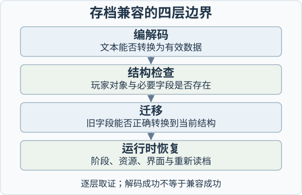

存档问题最容易误判的地方，是“导入成功”只说明按钮走完了一段代码，并不说明玩家状态已经被正确恢复。一个存档至少要经过四个边界：文本能否解码、解码结果是否像玩家对象、旧字段能否迁移到当前结构，以及运行时是否依据这些字段重建出同一个游戏状态。

排查时先问“哪一个边界失败”，再决定读源码、看样本还是做设备验证。不要一上来修改 JSON；那往往会把原始证据和迁移前状态一起毁掉。



*图：按失败所在层定位原因，不把外层可读当作真正兼容。*

## Android 与 Web 存档

Android 与 Web 使用不同的外层格式。Android 工具 `savecodec-rs`（源码定位：OrekiDawson/AD-Oreki-Edition-Android@fb1299a132f134eb4fab009643ee3fc3d6c57edf/tools/savecodec-rs）处理的是 Android 文本存档：

```text
AntimatterDimensionsAndroidSaveFormat + AAA + payload + EndOfSavefile
```

载荷中的 `0a`、`0b`、`0c` 分别还原为 `0`、`+`、`/`；随后补齐 Base64 的 `=`，解码并 gunzip。工具把输入限制为 32 MiB，解压结果限制为 64 MiB，退出码 0/1/2 分别表示成功、数据或 IO 错误、参数错误。这些是 Android 编解码器的边界，不是 Web 导出格式的通用规则。

Web 的 `serializer.js`（源码定位：OrekiDawson/AD-Oreki-Edition-Web@e1c93caa758de6c39cf814582123d4a35319eb25/src/core/storage/serializer.js） 则把对象经 `JSON.stringify` 转换：`Set` 变成数组，`Infinity` 变成字符串；之后依次执行 `TextEncoder`、pako deflate、字节转字符串、Base64，以及 `0`/`+`/`/` 的可打印化替换，最后附加 `EndOfSavefile`。新格式以 `AntimatterDimensionsSavefileFormatAAB` 开头。没有显式转换器和真实导入验证时，两个平台的文件不能因为都包含 `player` 字段就互相兼容。

Web 还保留旧存档的兼容路径：如果文本没有新的魔术前缀，`decodeText()` 会回退到旧的 `atob` 解码。这个回退只能说明“尝试按旧编码读取”，不能证明旧对象已经适配当前游戏。

## Web 读档的实际调用链

从浏览器本地存储恢复时，调用链可简化为：

```text
localStorage
  -> GameSaveSerializer.deserialize
  -> GameStorage.loadRoot
  -> GameStorage.loadPlayerObject
  -> migrations.patchPreReality
  -> deepmerge / 开发环境迁移
  -> migrations.patchPostReality
  -> UI、符文缓存、自动化后端和离线进度恢复
```

`GameStorage.loadRoot()` 先区分两种根结构。没有 `saves` 字段的旧对象会被放入槽位 0，并立即按当前多槽格式保存；有 `current` 与 `saves` 的对象则恢复当前槽位。于是，“旧格式被成功打开”可能已经伴随一次格式升级，原始文本必须在操作前另存。

进入 `loadPlayerObject()` 后，`checkPlayerObject()` 只做最低限度检查：对象不能为空，必须有 `money` 或 `antimatter`，并且不能递归发现 NaN。它不是完整 schema 验证器。检查通过后，迁移函数按顺序修改对象；缺失字段再由默认玩家结构补齐，最后才恢复 UI 状态、重建符文相关缓存并记录 `lastUpdate`。因此，解码成功、迁移成功和界面看起来正常是三个不同的结论。

`migrations.js` 把 `firstRealityMigration` 定为 13，并将迁移分为 `patchPreReality()` 与 `patchPostReality()`。前者负责跨越现实更新前后的结构边界，后者负责当前迁移表中更晚的字段变化。调查旧存档时，应记录输入对象的 `version`，并对照它实际经过的迁移区间，而不是只引用“当前版本支持旧档”。

## “像新档”时先定位回退点

`loadPlayerObject()` 在对象为空、解码失败或最低限度检查失败时，会深合并 `Player.defaultStart` 并重新设置创建时间。用户看到的新档界面，可能来自三类完全不同的原因：

1. 文本根本没有解码成对象；
2. 对象存在，但没有 `money`/`antimatter` 或含 NaN，被运行时判为无效；
3. 对象通过检查，但迁移、阶段门禁或 UI 恢复让可见页面回到较早阶段。

取证时应分别保留：原始文本哈希、解码后的根对象、迁移后关键字段，以及首次加载后界面显示的阶段。只截一张“导入成功”或“资源变少”的截图，无法区分这三种情况。

## 保存问题

Web 的 `canSave()` 会在三种状态下拒绝普通保存：正在选择符文、正在模拟进度，或游戏已进入禁止交互/保存的结束状态。`save()` 还会把根对象写成 `{ current, saves }`，而不是只写当前玩家对象。排查“文件时间没有更新”时，要同时检查保存条件、当前槽位和浏览器的 `dimensionSave` 键。

自动备份使用独立键名：正式环境为 `backupSave-{saveSlot}-{backupSlot}` 和 `backupTimes-{saveSlot}`；在线备份的间隔为 1 分钟、5 分钟、20 分钟和 1 小时，离线备份的间隔为 10 分钟、1 小时和 5 小时，另有一个保留槽。文件存在不代表它是最近一次有效状态；应读取备份时间并确认对应槽位。

导入流程也会主动保存：`import()` 解码并通过 `checkPlayerObject()` 后，调用 `loadPlayerObject()`，清理部分运行时状态，随后执行 `save(true)`。如果导入后立刻关闭页面，先确认 `canSave()` 没有因模拟或结束状态阻止这次写入。

## 一套可复现的排查顺序

### 1. 冻结证据

复制原始文件，不在原件上编辑；记录来源平台、游戏构建、浏览器或设备、文件大小、SHA-256 和导入时间。Android 夹具的路径、大小、哈希和阶段字段可参考 `savestates/manifest.json`（源码定位：OrekiDawson/AD-Oreki-Edition-Android@fb1299a132f134eb4fab009643ee3fc3d6c57edf/savestates/manifest.json）。

### 2. 只做编解码验证

Android 先用 `savecodec decode` 生成新 JSON，不要直接覆盖应用目录；Web 先独立调用序列化器或在浏览器副本中导入。此步只回答“文本能否解码”，不回答“玩家进度是否正确”。

### 3. 比较迁移前后字段

至少比较 `version`、现实/永恒/无限计数、主要货币、解锁标记、`lastUpdate` 和备份计时器。对字段缺失，要查迁移函数是补默认值、改名、转换类型，还是根本没有覆盖该旧版本。

### 4. 重新启动并复读

导入后保存、退出并重新启动，再读取同一槽位。第一次显示正确而重启后回退，重点查 `localStorage` 写入、槽位选择和自动备份；两次都正确但玩法阶段不同，重点查阶段门禁、缓存重建和离线模拟。

### 5. 用合法夹具复现

优先使用仓库中带哈希和来源的合法样本；`savestates/late/invalid/` 中标为负向夹具的文件只用于确认失败路径，不能当作跨版本兼容成功的证据。每次实验保留输入哈希、工具版本、迁移前后差异和重启结果。

## 兼容边界与安全结论

- 编解码兼容不等于 schema 兼容；能 gunzip 或 `JSON.parse` 只证明外层格式可读。
- 旧字段可迁移不等于阶段等价；默认值合并、解锁检查、缓存重建和离线模拟都可能改变可见结果。
- Web 多槽根对象、Android `player.json` 和备份槽不是同一层级的交换格式。
- 没有固定版本、原始哈希和真实重启结果的“互通成功”只能记为推断。
- 任何修复先复制存档；不要用手写 JSON 覆盖唯一用户文件，也不要把负向夹具发布成合法存档。

## 参考资料

- Android `savecodec-rs/README.md`（源码定位：OrekiDawson/AD-Oreki-Edition-Android@fb1299a132f134eb4fab009643ee3fc3d6c57edf/tools/savecodec-rs/README.md）、`savestates/manifest.json`（源码定位：OrekiDawson/AD-Oreki-Edition-Android@fb1299a132f134eb4fab009643ee3fc3d6c57edf/savestates/manifest.json）。
- Web `storage.js`（源码定位：OrekiDawson/AD-Oreki-Edition-Web@e1c93caa758de6c39cf814582123d4a35319eb25/src/core/storage/storage.js）、`serializer.js`（源码定位：OrekiDawson/AD-Oreki-Edition-Web@e1c93caa758de6c39cf814582123d4a35319eb25/src/core/storage/serializer.js）、`migrations.js`（源码定位：OrekiDawson/AD-Oreki-Edition-Web@e1c93caa758de6c39cf814582123d4a35319eb25/src/core/storage/migrations.js）。
- [Web 存档与自动保存](/player/gameplay/saves) · [协程 ABI 崩溃排查](/developer/troubleshooting/coroutine-abi)。

## 相关条目

[来源索引](/developer/references/source-index) · [Web 架构](/developer/architecture/web) · [Android 架构](/developer/architecture/android) · [故障排查](/developer/troubleshooting/)
