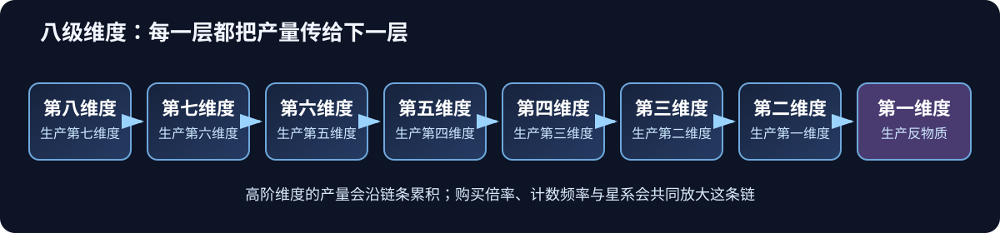

为什么购买第八维度，却能让第一维度在稍后变得如此庞大？为什么计数频率看起来只提高了十几个百分点，实际玩起来却远不止如此？答案藏在反物质维度的生产链里。

反物质维度（AD）共有八级。第一维度每秒生产反物质；更高阶维度生产低一阶维度。它们不是八台并排运转的机器，而是八层互相供给的工厂。

*图：高阶维度沿链条向下生产；这是本文后续数学近似中“连续积分”直觉的视觉版本。*

## 买来的与长出来的

维度的拥有数量包含购买及生产所得，但购买记录另有用途：在原版基础状态下，每买满同级十个维度，该级生产倍率乘以 2，单价进入下一档。

| 维度 | 首个价格（反物质） | 每十个价格倍率 |
| ---: | ---: | ---: |
| 1 | 10 | 1e3 |
| 2 | 100 | 1e4 |
| 3 | 1e4 | 1e5 |
| 4 | 1e6 | 1e6 |
| 5 | 1e9 | 1e8 |
| 6 | 1e13 | 1e10 |
| 7 | 1e18 | 1e12 |
| 8 | 1e24 | 1e15 |

第一维度起初每个只要 10 反物质，第一组共花 100；下一组单价却是 10,000。若已经购买七个，再买三个即可得到本组的倍率。看见面板上有成千上万个第一维度，不代表已经购买过成千上万个。

上表适用于原版正常状态、尚未进入无限后成本加速时；普通挑战 6 等会改变成本甚至支付资源。

## 时间的八次方

可以暂时把游戏简化为一道数学题。假设只有一个第八维度，没有其他初始维度，不再购买，倍率固定为 1。每个高阶维度每秒生产 0.1 个下一级维度，第一维度每秒生产 1 点反物质。

**第八维度 → 第七维度 → … → 第二维度 → 第一维度 → 反物质**

第七维度的数量随时间线性增长，第六维度则不断积累这些越来越多的第七维度，于是增长中出现平方项。每向下走一级，便再增加一次积分。最终，经过 $t$ 秒，第八维度所贡献的反物质在连续时间近似下为

$$\Delta AM=\frac{t^8}{8!\,10^7}.$$

这不是实际离散 tick 的精确模拟，也不考虑购买和动态倍率。若起初已有其他阶的维度，结果中还会出现较低次数的项。不过，光看这个模型就能发现游戏初期的一个秘密：当八级链条都参与生产时，时间延长至两倍，最高次项就会变为 256 倍。

让每一级生产都加速至原来的 $s$ 倍，则最高次项系数乘以 $s^8$。全链速度增加 10%，相应贡献约变为 $1.1^8\approx2.14$ 倍。两者并非立即翻倍的保证，而是理解全局加速价值的数学直觉。

## 星系改变了什么

计数频率缩短等效生产间隔，恰好是影响整条链的机制。原版基础效果如下：

| 基础星系数 | 单次升级效果 |
| ---: | ---: |
| 0 | ×1.125 |
| 1 | ×1.145 |
| 2 | ×1.165 |

第一个星系要 80 个第八维度，随后是 140、200。取得星系通常会清除当前维度、计数频率、维度提升等积累，却使重新购买的计数频率升级更强。星系达到三个后，计算规则会改变，后期还有复制器星系及膨胀星系参与计算。[计数频率](/player/original/ow-tickspeed)收录完整公式。

星系之前还有维度提升：前四次分别开放第五至第八维度，第五次解锁献祭。原版前五次的基础需求都是当前最高可用维度的 20 个，其后第八维度需求每次增加 15；每次提升强化部分维度，八次后全部维度都能受到影响。现实更新前，最早四次还另有「维度跃迁」的名称。

## 献祭究竟值不值

维度献祭让第一至第七维度的累计数量归零，通常保留购买记录，以换取第八维度倍率。乍看是牺牲大部分生产能力，实际上获得的强化位于整条链最上游。

以原版基础公式为例，累计献祭的第一维度数量为 $A$ 时，总献祭倍率为

$$\max\left(1,\frac{\log_{10}A}{10}\right)^2.$$

1e100 对应 ×100，1e1000 对应 ×10,000。这是总倍率，不是每一次都额外乘这么多。

完成无限挑战 2 后，基础公式变成 $A^{1/120}$。对 1e120 而言，新旧公式分别给出 ×10 与 ×144；但当累计量达到 1e1200，新公式给出 ×1e10，旧公式仅 ×14,400。早期看到的数字不一定能预测一项升级的长期价值。

还有一个漂亮的例外：成就 118「超过 9000 了！」要求献祭总倍率达到 1e9000，奖励竟然是献祭不再清除反物质维度数量。从此，「献祭」终于可以不献祭东西了。参见[维度献祭](/player/original/ow-dimensional-sacrifice)与[成就表](/player/original/ow-achievements)。

## 把生产链剪开

普通挑战 12 中，第三维度改为生产第一维度，第四维度生产第二维度，第一、第二维度都直接产反物质。原本的长链分成奇数与偶数两条短链，因此前面推导的八次项不再适用。这类挑战的乐趣之一，正是让已经熟悉的数学模型失效，再让玩家寻找新的有效模型。

下一层生产系统见[无限](/player/gameplay/infinity)。

## 资料来源
- [Antimatter Dimensions](https://antimatterdimensions.wiki.gg/index.php?title=Antimatter_Dimensions&oldid=3325)、[Dimensions](https://antimatterdimensions.wiki.gg/index.php?title=Dimensions&oldid=3102)、反物质维度源码（源码定位：IvarK/AntimatterDimensionsSourceCode@5409e320cecef96a917cca1dfb68f1f183e499ca/src/core/dimensions/antimatter-dimension.js；具体文件证据留在内部核验记录）。
- [Tickspeed](https://antimatterdimensions.wiki.gg/index.php?title=Tickspeed&oldid=3334)。
- [Dimension Boosts](https://antimatterdimensions.wiki.gg/index.php?title=Dimension_Boosts&oldid=3333)、维度提升源码（源码定位：IvarK/AntimatterDimensionsSourceCode@5409e320cecef96a917cca1dfb68f1f183e499ca/src/core/dimboost.js；具体文件证据留在内部核验记录）。
- [Dimensional Sacrifice](https://antimatterdimensions.wiki.gg/index.php?title=Dimensional_Sacrifice&oldid=3397)、[Antimatter Galaxies](https://antimatterdimensions.wiki.gg/index.php?title=Antimatter_Galaxies&oldid=3335)、星系源码（源码定位：IvarK/AntimatterDimensionsSourceCode@5409e320cecef96a917cca1dfb68f1f183e499ca/src/core/galaxy.js；具体文件证据留在内部核验记录）。
- [Normal Challenges](https://antimatterdimensions.wiki.gg/index.php?title=Normal_Challenges&oldid=3341)。多项式示例为本文基于基础生产率的数学推导。
- [原版成就表](https://antimatterdimensions.wiki.gg/index.php?title=Achievements&oldid=3363)：成就 118。

本文依据原版社区 Wiki 的资料独立编写，涉及其内容的改编按  [CC BY-SA 4.0](https://creativecommons.org/licenses/by-sa/4.0/)  共享；原文贡献者见各固定修订的页面历史。
