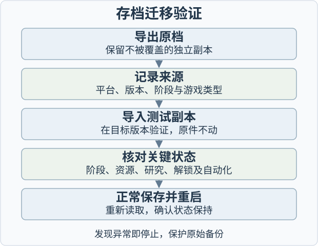

存档安全有两个相互衔接的环节：先确认当前进度已经保存，并保留一份独立备份；需要更新、换平台或回退时，再用备份验证目标版本是否能正确读写。能打开导入窗口，不等于存档已经安全迁移。

## 自动保存的边界

游戏会在正常游玩中定期保存；Android 版本也会在应用进入后台等生命周期变化时尝试保存。对普通购买和日常重置通常足够，但刚完成现实、永恒或其他重大重置后立刻强制结束进程，仍可能留下较早的状态。

重要进度后，让游戏正常运行片刻，再使用系统返回或应用自己的退出方式离开。桌面端可按当前快捷键执行保存或导出；移动端以实际界面为准，不要只凭另一平台的快捷键记忆操作。

## 导出与独立备份

卸载、清除应用数据或更换设备前，先用游戏内导出功能保存一份副本。安装预发布版、切换构建、尝试回退版本、导入另一份存档或进入会清除大量低层进度的重置系统前，也应先导出。

导出后确认完整文本或文件确实出现在系统分享、剪贴板或文件保存位置。备份不要只留在同一个应用的数据目录里；卸载、清除数据或站点数据重置可能同时带走原档和所谓备份。文件名应写清 Android/Web、原版/MOD、导出时的版本和大致阶段，方便比较多个副本，避免误导入。

无论是哪一种迁移，都先保留一份不会被游戏覆盖的原始副本。备份的价值不在于“按过导出”，而在于出错后仍能找回它。

## 更新或换平台前的验证流程

1. **导出原档并保留原件。** 不要让测试版本覆盖唯一正常存档。
2. **写清来源。** 记录 Android 还是 Web、原版还是 本 MOD、版本和导出时的阶段。
3. **用副本导入目标版本。** 预发布版优先使用副本或新档。
4. **检查读入结果。** 阶段和资源应处于预期位置，研究与解锁应成套，自动购买器和重置按钮应可用。
5. **重新打开后再确认。** 正常保存、关闭并重新打开，观察刚才的状态能否再次读出；确认后才考虑迁移主档。

*图：先保留原档，再验证副本；发现异常时不要继续覆盖主档。*

### 三种迁移不能混为一谈

**Android 与 Web**：两个版本都叫 本 MOD，不代表共享全部字段、默认设置或行为。平台构建、游戏版本和新增字段可能不同，应以对应版本明确支持跨端为前提。

**原版与 MOD**：MOD 可能增加设置、自动化或进度字段。旧版本即使勉强打开，也可能在下一次保存时丢失无法理解的字段；不要把“能显示页面”当成完整兼容。

**新版本与旧版本**：回退通常比升级更危险。旧版本可能不知道新版本写入的数据。需要回退时，使用迁移前的原始备份，不要拿已经被新版本保存过的唯一文件反复尝试。

## 怎样判断导入真的正常

导入副本后，先看阶段和关键资源是否仍在预期范围，再检查研究、成就、自动购买器和重置按钮是否成套可用。随后正常保存、关闭并重新打开，确认状态仍能读出。一次导入后页面能打开，不足以证明跨平台或跨版本兼容。

现实是更高层的重置，会清除许多永恒阶段的临时进度和当前时间研究配置；现实机器、符文和相关奖励则成为下一轮成长的基础。因此，现实后看到时间研究配置消失，并不等于存档损坏。真正需要警惕的是永久进度无故消失、存档反复回退，或重启后出现无法解释的资源变化。

## 发现异常时先保护现场

停止反复导入和清除数据，保留原始备份、当前目标版本、异常出现前的操作和必要截图。不要为了“再试一次”把唯一正常副本覆盖掉。存档可能包含完整进度和设置，不应公开贴到无关聊天或 Issue。

如果只是重置后数字变小，先确认这是否属于合法重置的清除范围；如果阶段凭空倒退、研究与成就不成套，或导入后第一次保存回到旧档，再按[玩家常见问题](/player/faq/)反馈，并说明 Android/Web、原版/MOD、版本、存档来源，以及异常是否能在重启后复现。

## 相关条目

[下载与版本](/player/download-and-version/) · [原版行为与 MOD 修改](/player/gameplay/original-vs-mod) · [阶段门禁](/player/gameplay/stage-gates) · [玩家常见问题](/player/faq/)

原版导出入口可参阅 [Antimatter Dimensions Wiki 的存档页面](https://antimatterdimensions.wiki.gg/wiki/Save)；平台实现和 MOD 行为可能不同，具体保留项以当前版本为准。
